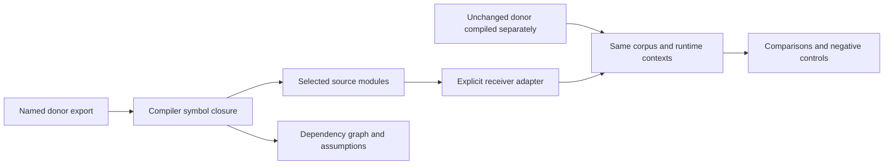

# Code Transplant

**Move the feature. Keep the evidence.**

Code Transplant extracts a named TypeScript parser from its source project,
adapts it through an explicit interface, and compares its behavior against the
unchanged original. It produces code you can inspect and a dependency and
verification record you can replay.

An open-source project from [Gradia](https://www.gradiahq.com).

## Run the first proof

```sh
git clone https://github.com/rudycelekli/code-transplant.git
cd code-transplant
npm ci
npm run demo
```

Requires Node.js 22 or newer. The demo uses an already vendored, pinned donor;
it does not need an API key, model, or a live source download.

The demonstration moves date-fns' ISO date parser into an example audit-event
importer. It extracts the referenced declarations, compiles the original donor
separately from the capsule, then compares tagged results in UTC, New York, and
Kathmandu. Deliberate offset and invalid-value errors must be detected. Inspect
the generated `.transplant/` directory for the capsule, report, and receipt.

The date-fns files are unchanged upstream sources at
[`313b902b9a72c64501074db9bc2b9897d2db5140`](https://github.com/date-fns/date-fns/tree/313b902b9a72c64501074db9bc2b9897d2db5140),
release v4.1.0. Their MIT license is retained. The receiving importer is a new
example application; a transplant into another mature open-source application
is the next validation milestone.

The retained [first proof](docs/evidence/) passed 2,085 comparisons with zero
disagreements, and both deliberately broken controls were detected. The release
regression suite passed 41 tests.

## What actually moves



The extractor follows the compiler's symbols instead of copying an entry
function or importing the whole package. The capsule records selected
functions, constants and types, their dependency edges, source ranges, source
and output hashes, and ambient assumptions. Unsupported dependencies and
effects produce an actionable refusal.

The verifier compares both the parser outcome and its receiving interface in
the demo. Invalid dates stay distinct from thrown errors and ordinary values.
A crashing command, malformed protocol, missing response, timeout, or output
limit violation refuses verification. Two implementations failing to execute
cannot earn agreement.

## Extract your own feature

```sh
npm run build
node dist/cli.js extract ./donor/src parser/index.ts parse ./new-capsule
```

Output directories must be fresh and separate from the donor. The initial
boundary supports named TypeScript functions and constants with statically
resolvable local dependencies. It rejects package dependencies, unsupported
loading, mutable module state, and unknown module effects. This conservative
boundary is intentional; it is not a general whole-program purity analysis.

When extracting third-party code, supply provenance and a license through the
library API:

```ts
import { extractFeature } from './dist/index.js';

const capsule = extractFeature({
  sourceRoot: './donor/src',
  entryFile: 'parser/index.ts',
  exportName: 'parse',
  outDir: './new-capsule',
  provenance: {
    repository: 'https://github.com/example/donor',
    revision: 'the-reviewed-commit',
    licenseFile: './donor/LICENSE',
  },
});
```

Add an adapter in the receiver that maps its interface to the extracted export.
The tool does not infer arbitrary business interfaces or secretly rewrite the
donor. The demo supplies a concrete, reviewable adapter.

## Verify your interface

A command reads JSON Lines on stdin and emits exactly one response for every
case id. Commands use argument arrays and run without a shell.

```json
{"id":"case-1","input":{"timestamp":"2024-02-29T12:00:00Z"}}
```

```json
{"id":"case-1","outcome":{"kind":"value","value":{"valid":true,"epochMs":1709208000000}}}
```

Thrown outcomes use `{"kind":"thrown","name":"TypeError","message":"..."}`.
Your reference and candidate must expose the same explicit JSON interface.
For example, write this contract at the project root:

```json
{
  "reference": {"argv": ["node", "reference-runner.mjs"]},
  "candidate": {"argv": ["node", "receiver-runner.mjs"]},
  "cases": [{"id":"leap-day","input":{"timestamp":"2024-02-29T12:00:00Z"}}],
  "contexts": [{"name":"UTC","env":{"TZ":"UTC"}}],
  "controls": [{"name":"known-bad","command":{"argv":["node","broken-runner.mjs"]}}],
  "timeoutMs": 5000,
  "outFile": ".transplant/report.json"
}
```

```sh
node dist/cli.js check contract.json
node dist/cli.js verify .transplant/report.json
```

Use `binding.files` with `{name,path}` entries to bind source, adapter, and
compiled artifacts; the verifier checks their hashes before and after the run.
`binding.contract` and `binding.capsuleDigest` connect the interface and the
extraction to the report. The demo supplies these bindings automatically.

## Reading the evidence

`VERIFIED` means the recorded reference and candidate agreed on the recorded
finite corpus and contexts, and supplied controls were detected. It is not
universal semantic equivalence, a standards-conformance verdict, a security
audit, or proof that the donor itself is correct.

The digest makes the report internally checkable. Offline verification detects
corruption and inconsistent decisions. Someone who can replace a report and
its digest can manufacture a new record; independent signatures and execution
attestations are future work.

Extraction only reads code. Verification executes the trusted commands you
choose. Timeouts and subprocess limits are operational controls, not a security
sandbox. The CLI is local; no company source needs to be uploaded.

## Why this could be useful

Use the workflow when a feature is embedded in a larger program, carrying an
entire package is unsuitable, or a migration needs an explicit compatibility
record. Normal package reuse remains appropriate when it solves the problem.

Software transplantation has prior art, including
[μScalpel](https://earlbarr.com/publications/autotransplant.pdf) and
[Foundry](https://discovery.ucl.ac.uk/id/eprint/10196236/). This project's product
hypothesis is that a small local workflow combining extraction, exposed
assumptions, and replayable behavioral evidence makes feature reuse easier to
review. We have not yet measured customer savings or demonstrated broad
architecture inference. See [research](docs/research/2026-10-06-transplantation.md)
and [product scope](docs/PRODUCT.md).

## Development

```sh
npm run check
```

The suite covers extraction boundaries, adversarial verifier failures, and the
real donor demonstration. CI retains the evidence as an artifact.
See [contributing](CONTRIBUTING.md) and the [architecture decisions](docs/adr/).

Tooling: Apache-2.0. Vendored donor and generated donor code: its retained MIT
license. Source provenance does not determine license compatibility for your
receiving application.
