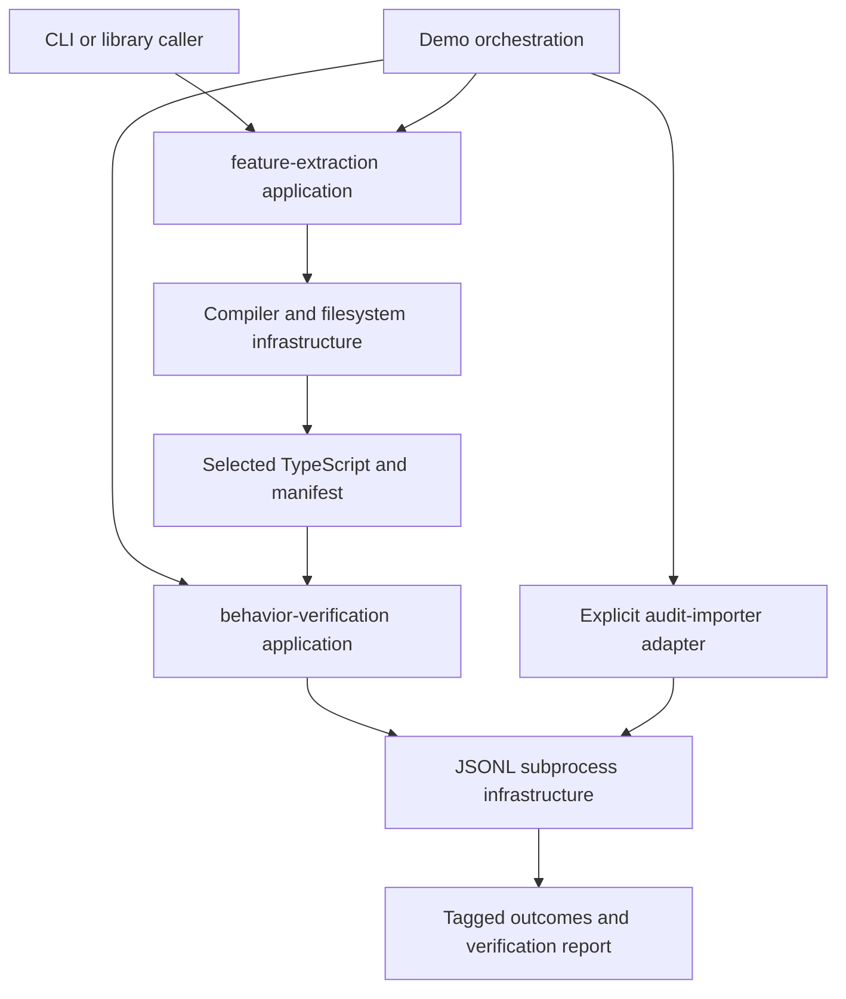

# Architecture

Two bounded contexts separate the evidence pipeline.

| Context | Owns | Public interface |
| --- | --- | --- |
| `feature-extraction` | Declaration selection, source dependency graph, unsupported-boundary refusals, capsule identity | `extractFeature(options): Manifest`, domain manifest/refusal types |
| `behavior-verification` | Explicit JSON cases, execution contexts, comparisons, negative controls, receipt consistency | `verifyBehavior(options)`, `verifyReport(report)`, corpus and domain contract types |

Each context contains domain entities, value objects, events, services, and
repository interfaces, plus application and infrastructure directories.
Unneeded extension directories have reserved empty exports. The public barrel
exports domain and application only. Compiler/filesystem and subprocess
implementations live under infrastructure.

The demo is an application-level composition, not a domain dependency between
the two contexts. It pins donor provenance, compiles independent source trees,
binds evidence files, invokes the verifier, and writes a concise receipt.

The extraction digest is deterministic over the manifest, including donor
license content identity. Behavioral reports bind runtime, cases, contexts,
commands, artifact hashes, comparisons, and controls. Reports include timestamps
and per-run paths, so independent runs produce different report digests even
when behavior agrees. Capsule digests and corpus digests remain comparable.

Local Ruflo swarm memory holds ADRs and context metadata outside Git. The ADR
index has two accepted decisions and one `depends-on` edge with no dangling
references or cycles. Research stays in a local reviewed Markdown artifact;
the invoked research skill requires user acceptance before optional research
namespace persistence.
